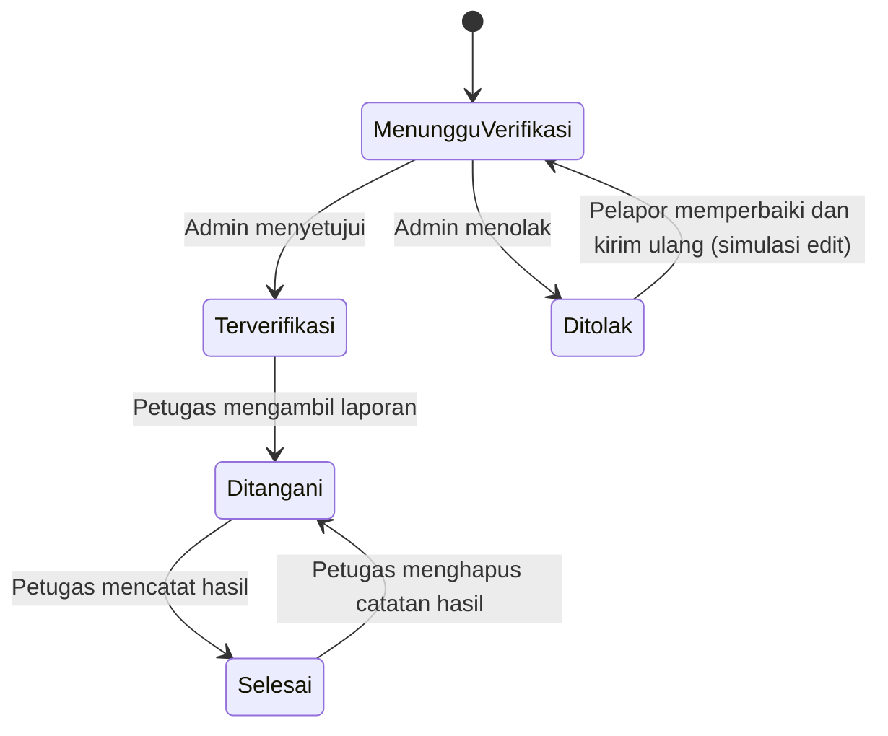

# 3. Peran pengguna dan alur aplikasi

## 3.1 Masyarakat

1. Login sebagai masyarakat.
2. Beranda menampilkan ringkasan laporan milik akun dan laporan lingkungan yang telah diverifikasi.
3. Pilih **Buat laporan**. Isi judul, kategori, tingkat urgensi, deskripsi, waktu, lokasi, dan lampiran opsional.
4. Setelah dikirim, status awal adalah **Menunggu verifikasi**. Laporan terlihat oleh pelapor dan admin, belum masuk feed warga.
5. Admin memverifikasi atau menolak. Hasil pemeriksaan tercatat di riwayat.
6. Pelapor mendapat notifikasi internal. Jika ditolak, catatan admin dapat digunakan untuk memperbaiki laporan.
7. Pelapor memantau status sampai **Selesai** dan membaca hasil penanganan.

Masyarakat dapat mengubah atau menghapus laporan miliknya. Pada detail laporan, tombol ubah tersedia ketika status menunggu verifikasi atau ditolak. Jika laporan berstatus ditolak diperbaiki dan disimpan, status kembali menjadi menunggu verifikasi untuk diperiksa ulang. Penghapusan tersedia dari detail.

## 3.2 Admin

1. Masuk ke dashboard admin.
2. Periksa daftar **Antrean verifikasi**.
3. Buka detail untuk meninjau kronologi, lokasi, dan deskripsi.
4. Pilih verifikasi atau tolak. Catatan pemeriksaan opsional dan disimpan sebagai riwayat.
5. Laporan terverifikasi muncul pada pantauan warga dan antrean petugas.
6. Gunakan **Manajemen akun** untuk menambah akun, reset password demo, atau mengaktifkan/nonaktifkan akun.
7. Gunakan **Rekapitulasi** untuk memilih bulan, menulis judul/ringkasan, menerbitkan rekap, dan mengunduh CSV.
8. Admin dapat menghapus laporan melalui halaman detail.

## 3.3 Petugas keamanan

1. Masuk ke **Antrean penanganan**.
2. Pilih laporan yang sudah diverifikasi admin lalu **Ambil laporan**. Status berubah menjadi **Ditangani**.
3. Buka detail laporan dan catat hasil setelah tindak lanjut dilakukan.
4. Menyimpan hasil mengubah status menjadi **Selesai** dan memicu notifikasi simulasi.
5. Catatan penyelesaian dapat diedit atau dihapus petugas.

## 3.4 Ketua RT

1. Masuk ke ringkasan Ketua RT.
2. Pantau jumlah laporan terpublikasi, aktif, dan selesai.
3. Buka arsip rekapitulasi yang diterbitkan admin.
4. Unduh data laporan dalam format CSV untuk diolah/diarsipkan.

## 3.5 Diagram status laporan

Laporan yang ditolak dapat diperbaiki oleh pelapor. Saat perubahan disimpan, sistem simulasi mengembalikan status ke menunggu verifikasi sehingga admin dapat memeriksa ulang.
